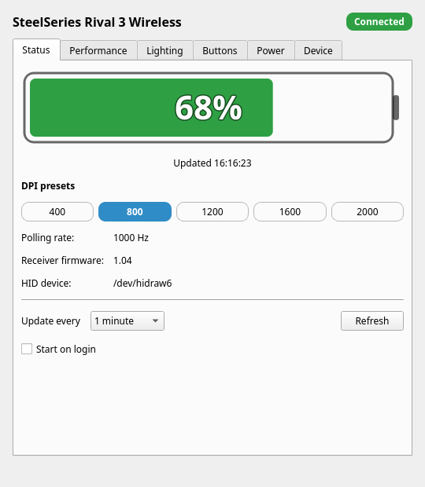
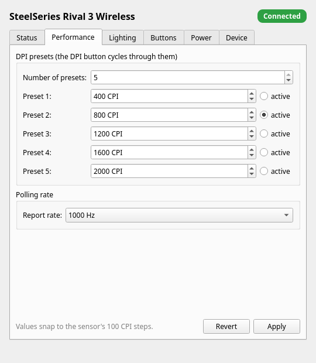
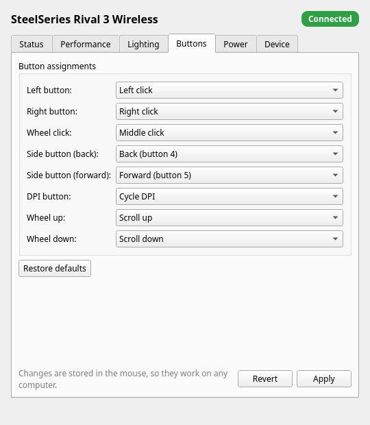

# ssmouse: an open-source SteelSeries GG for the Rival 3 Wireless

Configure and monitor a SteelSeries Rival 3 Wireless (USB `1038:1830`) without
SteelSeries GG, on **Linux, Windows and macOS**. It comes as a desktop app with a
battery tray icon, and as a scriptable CLI.

<p>



</p>

| Feature | GG | ssmouse |
|---|---|---|
| Battery level, tray icon, low-battery notifications | ✓ | ✓ |
| DPI presets (1–5, 100–18000 CPI) and active preset | ✓ | ✓ |
| Polling rate (125 / 250 / 500 / 1000 Hz) | ✓ | ✓ |
| Wheel LED: steady, colour shift, breathe, reactive, off | ✓ | ✓ |
| Button and wheel remapping: mouse buttons, DPI cycle, scroll, key combos, media keys, disable | ✓ | ✓ |
| Sleep timer, sensor rest, high-efficiency mode | ✓ | ✓ |
| Button debounce (in GG's device descriptor, not shown in its UI) | – | ✓ |
| Firmware version check and update | ✓ | ✓ (with your GG firmware files) |
| Pairing, factory reset | ✓ | ✓ |
| Profiles: export / import | cloud | JSON file |
| Macros, acceleration / angle snapping, Prism Sync, GameSense | ✓ | – (implemented in GG's Windows driver, not in the mouse) |

Every setting is written to the mouse and **saved in its flash memory**, so it
keeps working on any computer, even one without ssmouse. All of the above has
been verified on real hardware (firmware 1.04).

The protocol was reverse engineered from SteelSeries GG. No SteelSeries code,
data or firmware is included. See [Protocol reference](#protocol-reference).

---

## Install

### Linux

```console
git clone https://github.com/ViktorPetrov0605/ssmouse.git
cd ssmouse
./install.sh
```

The installer:

1. installs a udev rule (`udev/99-steelseries.rules` → `/etc/udev/rules.d/`,
   **needs sudo**) so your user can open `/dev/hidraw*`;
2. installs the package with the GUI (PySide6) using `pipx`, or into `./.venv`
   (via `uv` or `python3 -m venv`) if pipx is missing;
3. adds **ssmouse** to your application menu.

Options: `--no-gui` (CLI only), `--no-udev`, `--venv`, `--pipx`,
`--uninstall` (removes the udev rule). **Replug the receiver** after the first
install.

Manual install:

```console
sudo cp udev/99-steelseries.rules /etc/udev/rules.d/
sudo udevadm control --reload-rules
sudo udevadm trigger --subsystem-match=hidraw --subsystem-match=usb
pipx install '.[gui]'            # or: pip install '.[gui]' inside a venv
```

> Debian/Ubuntu may need `sudo apt install python3-venv` first.

### Windows / macOS

Download the app from the [releases page](https://github.com/ViktorPetrov0605/ssmouse/releases),
or install from source:

```console
pip install '.[gui]'
ssmouse-gui
```

Quit SteelSeries GG first: both programs talking to the mouse at once will
fight over its settings.

Windows and macOS need no udev rule. The libusb `hidapi` backend is picked
automatically. On macOS, grant Input Monitoring if prompted.

---

## The tray app

```console
ssmouse-gui               # window + tray icon
ssmouse-gui --minimized   # start hidden in the tray (what autostart uses)
ssmouse-gui --fake        # demo with captured data, no mouse needed
```

* Left-click the tray icon to show or hide the window. Right-click for *Refresh*,
  *Start on login* and *Quit*. Closing the window keeps the app in the tray.
* While the mouse is connected it updates every 1 minute by default
  (configurable from 15 s to 5 min).
* While the mouse is asleep, only the receiver is asked for the link state, which
  costs nothing on the radio. That check runs every 5 s, so a fresh reading
  appears soon after you touch the mouse.
* Launching it a second time just brings up the existing window.
* Tabs: **Status**, **Performance** (DPI presets, polling rate), **Lighting**,
  **Buttons** (press a shortcut to bind it), **Power** (sleep timer, sensor
  rest, high-efficiency mode, debounce) and **Device** (pairing, profiles,
  factory reset, firmware). Settings tabs apply when the mouse is awake.
* On GNOME the tray icon needs the *AppIndicator and KStatusNotifierItem
  Support* extension. Without a tray the app runs as a normal window.

---

## Status

Every value below was verified on real hardware (receiver firmware 1.04):

| Data | Command | Example |
|---|---|---|
| Battery level | `AA 01` | `47 00 00` → 71 % |
| DPI presets + active level | `A0`, `96` | 400 / **800** / 1200 / 1600 / 2000 |
| Polling rate | `97` | 1000 Hz |
| Firmware (receiver) | `D0` (fallback `90`) | `01 04` → 1.04 |
| Link status | `E8` (fallback `A8`) | `04` = linked, `01` = mouse asleep/off |
| Power mode | `AB` | idle timers (raw; units unconfirmed) |
| Charging | n/a | not reported by this model, always `null` |

The receiver itself answers `D0` and `E8`. Everything else is relayed to the mouse
over 2.4 GHz, so it only answers while the mouse is awake. `ssmouse` checks
`E8` first and reports *asleep* immediately instead of timing out.

---

## Command line

```
$ ssmouse info
SteelSeries Rival 3 Wireless
  vendor    : 1038
  product   : 1830
  model     : M-0000022
  serial    : -
  firmware  : 1.04
  interface : /dev/hidraw6 (if 3, usage 0xFFC0)
  transport : hidapi-hidraw
  connected : yes
  battery   : 71% (charge status not reported by this device)
  dpi       : 800 CPI (level 2/5; presets: 400, 800, 1200, 1600, 2000)
  polling   : 1000 Hz
  power     : saving=0 movement=50 idle_light=1200 idle_sleep=300 (raw)
```

Captured byte sequences can be replayed, so the CLI, GUI and tests run on any
machine: `ssmouse --fake --json info`, `ssmouse-gui --fake`, or set
`SSMOUSE_FAKE=1` in the environment.

### Configuration

```console
ssmouse set dpi 400,800,1600,3200 --active 2   # 1-5 presets, snapped to 100 CPI
ssmouse set dpi-level 3                        # switch preset
ssmouse set polling 1000                       # 125 | 250 | 500 | 1000
ssmouse set sleep 10m                          # 1-20 minutes
ssmouse set sensor-rest on
ssmouse set high-efficiency off                # on = 125 Hz, longest battery life
ssmouse set debounce 6 20                      # press / release in ms

ssmouse light steady ff5500
ssmouse light colorshift red,green,blue --duration 3000
ssmouse light breathe cyan --duration 4000
ssmouse light reactive 0000ff --flash ffffff --fade 800
ssmouse light off
ssmouse light preview ff0000                   # show now, don't store

ssmouse bind                                   # show the current mapping
ssmouse bind back key:ctrl+c
ssmouse bind forward media:volume-up           # mute, next, previous, play-pause, volume-up/down
ssmouse bind dpi disabled
ssmouse bind --reset

ssmouse profile show | apply | path | export FILE | import FILE
ssmouse pair                                   # pair a new receiver
ssmouse reset                                  # factory settings
ssmouse firmware                               # installed vs. newest known version
ssmouse firmware update PATH/TO/GG/firmware/272111664 [--dry-run]
```

Each change is saved to the mouse's flash. Add `--no-save` to try something
out: lighting and button changes made that way are lost when the mouse is
switched off. Your settings are also recorded in a profile file
(`ssmouse profile path`) so you can export them or re-apply them later.

### Firmware updates

SteelSeries' firmware can't be redistributed, so `ssmouse firmware update` uses
the files from a SteelSeries GG installation (`apps/engine/firmware/272111664/`).
It follows GG's procedure exactly: it flashes the mouse over 2.4 GHz, then the
receiver's radio and USB chips, which takes about a minute. The protocol has no
checksum, so ssmouse refuses unless the files are newer than what's installed,
the mouse is awake and the battery is at least 30 %. **Do not switch off the
mouse or unplug the receiver while it runs.** `--dry-run` validates the files
and shows the plan without writing anything. SteelSeries GG 122 ships 1.04,
which is what current mice already run.

### Usage

```
ssmouse [global options] {info,battery,dpi}
```

| Command | Description |
|---|---|
| `info` | device metadata + battery + DPI + polling + firmware + connection |
| `battery` | battery level only |
| `dpi` | DPI presets and the active CPI |

Global options (accepted before or after the command):

| Option | Description |
|---|---|
| `--json` | JSON output (stable keys, good for scripting) |
| `--watch` | repeat until Ctrl-C (TUI-style ANSI redraw on a TTY) |
| `--interval SECONDS` | watch interval (default `2.0`) |
| `--debug` | hexdump every HID report to stderr |
| `--list` | list detected SteelSeries HID interfaces and exit |
| `--fake` | replay captured data instead of hardware |
| `--backend …` | `auto` (default), `hidapi-hidraw`, `hidapi-hid`, `ctypes-hidraw` |
| `--path /dev/hidrawN` | force a specific device node |
| `--interface N` | force a specific HID interface number |
| `--framing …` | `default`, `no-id`, `canonical`, `short-3`, `report-id-0` |
| `--retries N` | command retries (default `2`) |
| `--timeout-ms MS` | read timeout per attempt (default `400`) |
| `--version`, `-h/--help` | |

### Examples

```console
ssmouse info
ssmouse --json info | jq '.battery.level'
ssmouse --json dpi
ssmouse --watch --interval 5 battery
ssmouse --debug battery       # show TX/RX hexdumps on stderr
ssmouse --list                # which hidraw node is the control interface?
```

### JSON schemas

`info`:

```json
{
  "name": "SteelSeries Rival 3 Wireless",
  "vendor_id": "1038",
  "product_id": "1830",
  "model": "M-0000022",
  "manufacturer": "SteelSeries",
  "serial_number": null,
  "firmware": "1.04",
  "firmware_source": "dongle",
  "path": "/dev/hidraw6",
  "interface_number": 3,
  "usage_page": "0xFFC0",
  "backend": "hidapi-hidraw",
  "battery": {"level": 47, "charging": null},
  "dpi": {
    "level_max": 5,
    "active_level": 2,
    "presets": [
      {"level": 1, "sensor": 4,  "cpi": 400},
      {"level": 2, "sensor": 6,  "cpi": 600},
      {"level": 3, "sensor": 16, "cpi": 1400},
      {"level": 4, "sensor": 32, "cpi": 2800},
      {"level": 5, "sensor": 48, "cpi": 4100}
    ],
    "current_cpi": 600,
    "current_sensor": 6
  },
  "polling_rate_hz": 250,
  "connected": true,
  "power_mode": {"power_saving": 0, "movement_saving": 0,
                 "idle_lighting": 600, "idle_sleep": 900},
  "protocol": {"framing": "report_id=none size=64 pad=True", "source": "…"}
}
```

`firmware_source` is `"dongle"` when `D0` answered and `"mouse"` when only the
`90` fallback answered.  Any read that fails (device asleep, unsupported,
timeout) yields `null` for that field; `info` adds an `"errors"` array when the
battery read failed.

`battery` → `{"level": 47, "charging": null}`

`dpi` → `{"available": true, "level_max": 5, "active_level": 2,
"presets": […], "current_cpi": 600, "current_sensor": 6}`; when no valid
response arrives, `{"available": false, …, "reason": "…"}`.

### Exit codes

| Code | Meaning |
|---|---|
| `0` | success |
| `1` | I/O or protocol error (e.g. device asleep) |
| `2` | no supported SteelSeries device found |

---

## Protocol reference

Recovered by static analysis of SteelSeries GG 122 (its per-device descriptors),
then confirmed against the hardware. Only the facts needed for interoperability
are documented here.

**Interface.** USB interface **3**, usage page `0xFFC0`, usage `0x0001`
(the `/dev/hidrawN` number varies). Interface 2 (usage page
`0xFF00`) is enumerated first but has **no working OUT
endpoint** on this model: writes fail with `EPIPE`. `ssmouse` ranks interface
3 first and automatically fails over.

**Framing.** The descriptor declares a 65-byte report whose byte 0 is the
constant `report_id = 0x00`. On Linux the kernel maps the first buffer byte to
the HID report `wValue`, so the working forms are:

```
verified   : [opcode, ...payload..., pad to 64]      # default
canonical  : [0x00, opcode, ...payload..., pad to 65] # --framing canonical
```

Input reports are unnumbered 64-byte interrupt-IN transfers; on Linux they
arrive without a report-ID prefix, so `data[0]` is the first struct field.

**Opcode masks.** Plain reads are `0x80 | op`; dongle reads are
`0xC0 | op` (`read-mask = 0x80`, `dongle-read-op-mask = 0x80|0x40 = 0xC0`).
The v1 Rival 3 Wireless descriptor therefore declares `D0` for firmware and
`E8` for RF status, while the observed engine traffic used the `0x80` variants
`90`/`A8`; `ssmouse` sends the descriptor variant first and falls back.

**Interface selection.** The command interface is identified by
**usage page `0xFFC0` / usage `0x0001`** (interface 3 on this device). The
`/dev/hidrawN` node number is *not* stable: it changed from hidraw7 to hidraw6
after a receiver replug. `ssmouse` ranks interfaces by usage page from sysfs
(`HID_PHYS=…/inputN` + report descriptor), not by node name; use
`ssmouse --list` to see the current mapping. Interface 2 (`0xFF00`) is the
async sync/event interface and has no usable OUT endpoint (writes → `EPIPE`).

**Timing.** At least ~30 ms between commands, 300-800 ms read timeout, 2
retries (all vendor constraints, implemented in `Protocol`/`Mouse`).

**Commands.**

```
battery      TX: AA 01                       RX: level uint16 LE @0, charge @2
dpi          TX: A0 (read-op 0x20)           RX: level_max @0, active_level @1,
                                                 5 x uint16 LE sensor @2..12
dpi-level    TX: 96 (read-op 0x16)           RX: active level 1..5 @0
polling      TX: 97 (read-op 0x17)           RX: level 0..3 -> 1000/500/250/125
firmware     TX: D0 (dongle-read 0x10)       RX: fw_major @0, fw_minor @1
                fallback: 90 (read-op 0x10)
rf-status    TX: E8 (dongle-read 0xA8)       RX: 4 = connected @0
                fallback: A8 (read-op 0xA8)
power-mode   TX: AB (read-op 0x2B)           RX: u8 power_saving, u8
                                                 movement_saving, u16 LE
                                                 idle_lighting, u16 LE idle_sleep
```

**Write commands.** The mouse does not answer writes; read the value back
to verify.

```
polling      17 level                         0..3 = 1000/500/250/125 Hz
dpi          20 count active s1..s5           u16 LE sensor values
power        2B saving movement u16 idle_light u16 idle_sleep_s
debounce     1E make_ms break_ms              read with 9E
live colour  13 01 r g b                      until 18 (restart lighting)
buttons      19 + 7 x (fn, k1, k2, k3, k4)    L, R, M, back, forward, DPI, unused
wheel        1A + 2 x (fn, k1..k4)            up, down
             fn: 00 off, 01-06 mouse buttons, 30 DPI, 31/32 scroll,
                 51 keys (modifier usages then key usage), 61 consumer usage
lighting     03 00 off16 len16 data           48-byte chunks of a 92-byte effect
             05 00 10FF 00000000 len16        push to effect 0xFF10
             1C 00 0000 0000 00               bind the LED to effect 0
save         09                               store everything in flash
factory      1B
pair         71 00, poll E8 for 4, 73 on timeout
firmware     (08|m) erase, (03|m) buffer, (05|m) push; m = 00 mouse, 40 receiver
```

The 92-byte effect is `u32 duration_ms, i32 wave, i16 x, i16 y, 4 x u8 scale,
u8 overflow + 3 pad, u32 trigger mask, u8 sections, rgb initial, 16 x (rgb,
u8 share of the cycle in 1/255)`; see `ssmouse/lighting.py`.

**DPI conversion.** The DPI struct stores sensor values, not CPI. The full
`truemove-air` table (`0x00 → 100`, `0x02 → 200`, … `0xD6 → 18000`) is embedded
in `ssmouse/protocol.py`; values missing from the table use the vendor
approximation `100 * floor(sensor * 0.8)`, and values outside `0x00..0xD6` are
invalid (`cpi: null`).

**Charging.** The Rival 3 Wireless runs on AA batteries; its descriptor
declares the charge-status byte as a constant `0x00`. `ssmouse` therefore
reports `"charging": null`. `Protocol(charging_supported=True)` enables real
charge parsing for other models.

---

## Project layout

```
ssmouse/
├── transport.py   # hidapi (hidraw + libusb backends) and ctypes hidraw fallback
├── protocol.py    # framing, packet builders, parsers, CPI table
├── device.py      # VID/PID detection, interface ranking, failover, high-level reads
├── status.py      # one-shot "read everything" shared by CLI and GUI
├── fake.py        # captured/replay transport used by tests and --fake
├── lighting.py    # wheel LED effect encoder (GG's libsteel format)
├── bindings.py    # button / wheel mapping encoder, key and media names
├── profile.py     # JSON profile, apply to mouse, config directory per OS
├── firmware.py    # version check, package validation, GG's update sequence
├── cli.py         # info/battery/dpi, --json, --watch, --debug
├── cli_config.py  # set / light / bind / profile / pair / reset / firmware
└── gui/
    ├── model.py     # Qt-free state: polling, last-known battery, alerts
    ├── widgets.py   # battery gauge, tray icon renderer
    ├── pages.py     # Performance, Lighting, Buttons, Power, Device tabs
    ├── app.py       # window, tray, device worker thread, single instance
    └── autostart.py # start on login: XDG / Windows Run key / LaunchAgent
tests/             # pytest suite (no hardware needed)
tools/probe.py     # hardware probe: enumeration, descriptors, commands, raw hex, pairing
packaging/         # PyInstaller entry points (release workflow builds all OSes)
udev/99-steelseries.rules
data/ssmouse-gui.desktop
install.sh
```

### Architecture

`cli` / `gui` → `status` → `device.Mouse` → `protocol.Protocol` ↔ `transport.Transport`.

* `transport.py` only moves bytes. Three interchangeable backends:
  the `hidapi` package's **hidraw** backend (Linux, works with the udev rule),
  its **libusb** backend (Windows/macOS), and a pure-`ctypes` hidraw fallback
  used when `hidapi` cannot be installed.
* `protocol.py` knows every opcode and response layout and contains no I/O.
  New protocol details are a one-line change there.
* `device.py` handles enumeration, control-interface ranking, the 30 ms command
  pacing, retries, and failover to the next interface on `EPIPE`.
* `fake.py` replays captured bytes; the tests never need the mouse.

---

## Troubleshooting

**`mouse is not linked to the receiver (asleep or switched off)`**
Wireless mice sleep when idle. Move the mouse (or click a button) and retry.
The GUI shows the last known level in grey until the mouse wakes up.

**`no response within 400 ms` / `Battery: unavailable`**
The mouse dropped the link mid-read. Retry after moving it.
`--retries 5 --timeout-ms 800` can help the first command after wake-up.

**`connected: false` even after moving the mouse**
Usually the batteries are empty. Below a few percent the mouse cannot hold the
2.4 GHz link, and its scroll wheel blinks white while it searches. Replace the
batteries first. If it still won't link, it may be paired to another receiver.
Pair it again with `ssmouse pair` (or *Device → Pair mouse with receiver*),
then switch the mouse off and on in 2.4 GHz mode within 20 seconds. This
writes `71` (pair_dongle), polls `E8` every 2 s (success = `4` twice) and sends
`73` (reset_wireless) on timeout, the same sequence SteelSeries GG uses.

**`no 1038:… device found`**
* Check `lsusb | grep 1038` and `ls -l /dev/hidraw*`.
* The mouse may be switched off, out of battery, or paired to another dongle.
* On Linux install the udev rule (`./install.sh`) and replug the device.
* Use `ssmouse --list` to see which interfaces are detected.

**`EPIPE` / `Broken pipe` on write**
The selected interface has no OUT endpoint. `ssmouse` switches to the next
candidate automatically, but you can force the known-good one:
`ssmouse --interface 3 info` or `ssmouse --path /dev/hidraw7 info`.

**Wrong interface on a different model**
Use `ssmouse --list`, then `--interface N` / `--path /dev/hidrawN`. The
`--framing canonical` or `--framing short-3` presets cover firmware variants
that include a report-ID byte or use a short report.

**`hidapi` will not install**
On Linux the pure-`ctypes` hidraw fallback needs no extra packages:
`ssmouse --backend ctypes-hidraw info`. (Windows/macOS require `hidapi`.)

**Permission denied on `/dev/hidrawN`**
The udev rule is missing or not applied:
```console
sudo cp udev/99-steelseries.rules /etc/udev/rules.d/
sudo udevadm control --reload-rules && sudo udevadm trigger
```
Then unplug/replug the mouse.

**WSL**
USB HID passthrough must be configured (`usbipd-win`); otherwise run the tool
on Windows directly.

---

## Development

```console
python3 -m venv .venv && .venv/bin/pip install -e '.[gui,dev]'
QT_QPA_PLATFORM=offscreen .venv/bin/python -m pytest
.venv/bin/ruff check ssmouse tests
```

The suite (`tests/`) covers battery parsing against the real capture, DPI
parsing/CPI conversion, polling/firmware/status parsers, all framing variants,
interface ranking and EPIPE failover, timeout behaviour, the CLI (including
`--watch` and `--debug`) and the packaged udev/installer/README assets. It
runs entirely on the fake transport. GUI widget tests are skipped when PySide6
is not installed.

Live verification against the hardware (when connected):

```console
.venv/bin/python tools/probe.py --list
.venv/bin/python tools/probe.py --commands battery,dpi,dpi-level,polling,firmware,rf-status,power-mode
.venv/bin/python tools/probe.py --framing canonical --commands battery
.venv/bin/python tools/probe.py --raw aa01
```

### Adding a model

1. Add the PID + name to `PRODUCT_NAMES` / `MODEL_NUMBERS` / `KNOWN_PIDS` in
   `ssmouse/protocol.py`.
2. If the firmware framing differs, add a `FRAMING_PRESETS` entry.
3. If the sensor has a different CPI table, add it next to
   `_TRUEMOVE_AIR_TABLE`.
4. Add a capture to `ssmouse/fake.py` and a parser test.

---

## Limitations

* Only the Rival 3 Wireless (`1038:1830`, firmware 1.04) is verified. Related
  PIDs are detected but not validated.
* The mouse cannot report its lighting or button mappings, so ssmouse shows
  what it last applied (stored in the profile).
* Bluetooth mode is not supported. GG's own descriptor disables every
  setting in Bluetooth mode; the vendor protocol needs the 2.4 GHz receiver.
* Macros, acceleration/deceleration, angle snapping, Prism Sync and GameSense
  are implemented by SteelSeries GG's Windows driver on the computer, not by
  the mouse, so there is nothing to port at the protocol level.
* The firmware update runs exactly GG's sequence but has not been exercised
  on hardware, since no firmware newer than 1.04 exists to install.
* Windows and macOS builds pass CI but have not been tried on real hardware yet.
